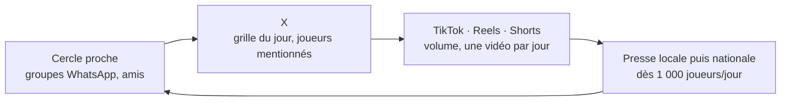

# Stratégie sociale et bouche-à-oreille

Proposition du 22 novembre 2026, à valider. Complète [`VIRALITE.md`](VIRALITE.md) (leviers produit, recherches de la veille) et [`LANCEMENT.md`](LANCEMENT.md) (comptes, bios, accroches).

## 1. Objectif et mesures

**Objectif : devenir le Métrodoku des noms IKEA.** Un rendez-vous quotidien qui se partage dans les groupes d'amis, puis sur X, puis dans la presse.

| Indicateur | Définition | Point de départ (22/11) |
|---|---|---|
| **Joueurs du 10 du jour** (indicateur principal) | appareils qui finissent la grille du jour | 8 |
| Visiteurs | appareils distincts par jour | 21 → 135 → 56 (20, 21, 22/11) |
| Partages | partages et copies par jour | 37 |
| Boucle défi | ouvertures de lien défi ÷ partages | 16 ÷ 37 ≈ 0,43 |
| Rétention | part des joueurs du jour J revenus à J+1 et J+7 | à mesurer |
| Provenance | visiteurs par `utm_source` | 193 en direct sur 7 jours |

Jalons : 100 joueurs du jour (fin semaine 2), 1 000 (fin semaine 6, seuil pour la presse), 10 000 (palier Métrodoku).

## 2. Ce que dit la recherche

**Le bouche-à-oreille passe d'abord par les messages privés.**
- Wordle : 35 % des joueurs ont déjà posté leur score en public, 12 % presque tous les jours. Le reste circule en messages et en groupes (YouGov UK).
- Sa grille d'emojis, sans spoiler et sans URL, a été le moteur : 90 joueurs le 1/11/2021, 300 000 le 2/1/2022, 2 M une semaine après l'article du NYT. La presse fait le saut d'échelle.
- Métrodoku a suivi la séquence serveur privé entre amis, puis X (le créateur demandait aux joueurs de le mentionner), puis Le Parisien, Actu Paris et Konbini. Il comptait 40 000 à 50 000 joueurs par jour un mois après le lancement (blog du créateur), et 10 articles de presse.
- Sutom a atteint 300 000 joueurs par jour en juin 2022 par « effet boule de neige » des retweets.
- Costcodle, jeu de fan d'une enseigne, affiche une mention de non-affiliation : c'est le cas le plus proche de CLIKEA.

**TikTok** : canal de volume, chaque vidéo est un nouveau tirage.
- Le nombre d'abonnés n'est pas un critère direct de recommandation.
- Fréquence : 6 à 10 posts par semaine donnent +29 % de vues par post par rapport à un par semaine. La médiane reste autour de 500 vues (Buffer, 11,4 M posts).
- Durée : les vidéos de plus de 60 s ont +43 % de portée (Buffer, 1,1 M vidéos), mais la cause n'est pas démontrée. Fourchette 30 à 90 s selon Fanpage Karma.
- 49 % des consommateurs se servent de TikTok comme moteur de recherche : mettre « quiz IKEA », « KALLAX » à l'écran et en légende.
- Un compte Business n'a accès qu'à la bibliothèque de musique commerciale.
- Promettre une récompense contre de l'engagement rend la vidéo inéligible au fil For You.
- Le hashtag #IKEA dépasse 4,6 Md de vues. IKEA UAE a lancé en 2026 un défi de prononciation des noms : le thème est validé par la marque.
- « Ikea or Death? » (produit IKEA ou groupe de death metal ?) est devenu viral en moins de 24 h.

**Instagram** : temps de visionnage, likes et envois en message (le signal le plus fort vers les non-abonnés, selon Mosseri). Fréquence de 3 à 5 posts par semaine. Les Trial Reels (test auprès des non-abonnés) ouvrent à partir de 1 000 abonnés (à confirmer). Les posts collaboratifs profitent au compte qui les lance.

**X** :
- Pénalité des liens : les données se contredisent. Buffer mesure 0 % d'engagement médian pour les posts à lien des comptes non Premium ; Musk dit en juillet 2026 qu'il n'y a plus de pénalité. La parade sans coût : grille en image et en texte, lien en réponse.
- Comptes automatisés : label « automated » obligatoire. Les posts automatiques sont permis ; les réponses et mentions automatiques en masse sont sanctionnées.

**Reddit** :
- r/InternetIsBeautiful interdit les jeux web.
- r/france n'accepte un projet perso que d'un compte actif, dans le Forum Libre ; un compte créé pour l'autopromotion est banni.
- r/WebGames tolère l'autopromotion, mais les posts « I made a daily… » y font 0 à 5 votes.
- La niche avec un angle qui lui parle marche mieux : Shapez.io a fait 1 300 votes sur r/factorio.
- L'API publique ferme aux nouvelles demandes : tout se fait à la main.

**Autres canaux** :
- Show HN est un coup de dés : Rogule, passé en une, est monté à 2 000 joueurs par jour.
- Les sites de listes « jeux comme Cémantix » (Alucare, Gamewave) relaient les jeux quotidiens.

Sources complètes : [section 10](#10-sources).

## 3. La stratégie en une phrase

**Le produit fait le bouche-à-oreille, les réseaux l'amorcent, la presse le multiplie.** On reproduit la séquence Métrodoku :

## 4. Les canaux, leur rôle, leur rythme

| Canal | Rôle | Rythme | Format principal | Qui publie |
|---|---|---|---|---|
| Groupes privés | cœur du bouche-à-oreille | chaque partie | grille + ticket + lien défi (dans le jeu) | les joueurs |
| X | joueurs engagés, journalistes | 1 par jour + réponses | « CLIKEA du jour #N » : grille en image, lien en réponse, piège d'hier | l'agent (label automated), réponses validées |
| TikTok | volume | 1 par jour | vidéo 45–75 s « devine avant la réponse », carrousels en test | l'agent via l'outil de planification |
| Instagram | volume, envois en message | 4 à 5 par semaine + Story quotidienne | Reels (mêmes vidéos), carrousel, Story avec sticker quiz | idem |
| YouTube Shorts | longue traîne, recherche | reprise des vidéos | idem | idem |
| Bluesky | public tech et européen | reprise de X | idem X | l'agent (API) |
| Reddit | coups ciblés | 1 post par communauté, une fois | angle propre à chaque communauté (r/IKEA, Forum Libre r/france, r/WebGames) | César ou Ben, depuis leurs vrais comptes |
| Presse et listes | saut d'échelle | dès 1 000 joueurs/jour | communiqué court, angle humain + chiffre | l'agent rédige, César envoie |

## 5. Les contenus

**Ne jamais spoiler la grille du jour.** Les contenus utilisent la grille d'hier, la partie libre et les statistiques du jeu.

1. **« Devine avant la réponse »** : 5 produits en vidéo, 3 s de photo, puis le nom. Accroche : « 95 % des gens ratent le n° 4 ». Pied : « Le 10 du jour sur clikeagame.com ».
2. **Le piège d'hier** : le produit le plus raté de la veille, avec son vrai taux (Supabase). « Hier, 71 % ont raté ce meuble. »
3. **L'orthographe** : « KALLAX, CALLAX ou KALAX ? Commente. »
4. **IKEA ou pas IKEA ?** : un vrai nom contre un nom inventé ou un nom de ville suédoise. Format qui a déjà fait ses preuves.
5. **Les chiffres du jeu** : le nom le plus connu, le moins connu, le record de série.
6. **Les joueurs** : repartager (avec accord) les meilleurs tickets et les séries.

Chaque contenu porte une question qui appelle un commentaire ou un envoi (« envoie à celui qui a monté ton BILLY »), jamais de récompense contre de l'engagement.

## 6. Ce que l'agent fait, et comment

**Production quotidienne automatisée**
- Un script tire les stats de la veille (Supabase), compose les vidéos verticales (ffmpeg : photos, texte, jingle de caisse maison, sans musique tendance) et les visuels (ticket, grille).
- Il écrit légendes et accroches avec DeepSeek V4.1 Flash, et met un lien UTM par post (`utm_source=tiktok&utm_content=<id>`).
- Pas de voix de synthèse au départ : texte à l'écran et sous-titres. Si on en ajoute une, l'étiquette IA est activée (TikTok, Meta, AI Act art. 50).

**Validation**
- Chaque dimanche, l'agent prépare la semaine (7 vidéos, 7 posts X, les Stories) sur une page de validation.
- César ou Ben valident, corrigent ou suppriment.
- Les posts validés sont programmés. Les réponses aux joueurs sont préparées par l'agent et envoyées après validation.

**Publication**

| Plateforme | Route | Pourquoi |
|---|---|---|
| TikTok | outil de planification déjà audité | l'API directe garde les posts privés tant qu'elle n'est pas auditée |
| Instagram | outil de planification ou API Graph | compte professionnel requis |
| YouTube | outil de planification ou API Data | utilisable |
| X | outil de planification, ou API à 0,015 $ par post sans lien | lien mis en réponse |
| Bluesky | API ouverte | gratuite |
| Reddit | à la main | API fermée aux nouvelles demandes, autopromotion automatisée bannie |

- Outil recommandé : **Postiz hébergé** (≈ 23–29 $/mois) : TikTok, Instagram, YouTube, X, Bluesky et Reddit, avec une API et un serveur MCP utilisables par l'agent.
- Option gratuite : **Buffer** (3 canaux, 10 posts programmés par canal, export d'analytics payant).

**Comptes à créer** : TikTok, Instagram (professionnel), YouTube, Bluesky, avec l'adresse oko@ comme pour X. Un code SMS peut être demandé.
- Bio : « Le jeu des noms IKEA. Jeu de fan, non affilié à IKEA. »
- Pas de logo IKEA ni de « IKEA » dans le pseudo.

## 7. Suivi et itération

- **Rapport hebdomadaire**, chaque lundi matin (routine) :
  - joueurs du jour et rétention ;
  - provenance par `utm_source` ;
  - boucle défi ;
  - les 3 meilleurs et les 3 pires posts par plateforme (vues, partages, clics) ;
  - ce qui change la semaine suivante.
- **Tableau de bord PostHog « Croissance »** : joueurs du 10 du jour, nouveaux et revenants, provenance, partages, boucle défi.
- **Règle d'itération** : chaque semaine, un seul format change ou entre en test. Un format qui ne dépasse pas la médiane de la plateforme pendant 2 semaines sort.
- **Presse** : un premier pitch quand le 10 du jour dépasse 1 000 joueurs sur 3 jours, avec l'angle et le chiffre du moment.

## 8. Plan des 30 premiers jours

| Semaines | Actions |
|---|---|
| 1 · amorcer | Comptes créés et habillés ; outil branché ; mention « non affilié » ajoutée au jeu ; César, Ben et Simon envoient le 10 du jour dans 5 groupes chacun ; X : un post par jour |
| 2 · rythme | TikTok, Reels et Shorts : une vidéo par jour ; premier rapport hebdomadaire ; Story quotidienne |
| 3 · communautés | Post r/IKEA (angle « vous connaissez vos meubles ? ») ; Forum Libre r/france ; proposition aux listes Alucare et Gamewave ; premiers posts collaboratifs avec des créateurs déco ou humour |
| 4 · tester | « IKEA ou pas IKEA ? » ; Show HN en anglais si la version anglaise tient ; presse si le seuil est atteint |

## 9. Risques

- **Marque IKEA** : précédents IkeaHackers (2014, IKEA a reculé) et *The Store Is Closed* (2022, 10 jours pour retirer la signalétique). Les photos copiées d'ikea.com sont le point le plus exposé. Mesures :
  - mention de non-affiliation ;
  - aucune monétisation ;
  - captures du jeu plutôt que photos brutes en plein écran ;
  - retrait immédiat sur demande.
- **Automatisation** : sur X, label « automated » et réponses validées par un humain. Sur TikTok et Instagram, publication via un outil audité, jamais de scripts de navigateur pour publier ou interagir.
- **Contenus IA** : étiquette dès qu'il y a une voix ou une image de synthèse réaliste.
- **Spoilers** : aucun contenu ne montre la grille du jour.

## 10. Sources

- Wordle : https://en.wikipedia.org/wiki/Wordle · https://www.gamedeveloper.com/marketing/josh-wardle-reflects-on-the-the-unconventional-road-to-wordle-s-success · YouGov : https://yougov.com/en-gb/articles/40799-wordle-starter-words-hard-mode-and-x6-how-are-brit
- Métrodoku : https://metrodoku.fr/blog/un-mois-metrodoku.html · https://jdavid.fr/projets/metrodoku · https://www.paris.fr/pages/3-questions-a-jean-david-createur-du-jeu-metrodoku-35266 · https://www.franceinfo.fr/economie/transports/j-ai-ete-completement-depasse-par-le-succes-de-ce-jeu-rencontre-avec-le-createur-de-metrodoku-le-nouveau-jeu-qui-passionne-les-usagers-du-metro-parisien_8026553.html
- Sutom : https://www.connexionfrance.com/magazine/thousands-play-wordle-like-word-game-inspired-by-old-french-tv-show/116441
- TikTok : https://newsroom.tiktok.com/en-us/how-tiktok-recommends-videos-for-you · https://buffer.com/resources/how-often-should-you-post-on-tiktok/ · https://buffer.com/resources/longer-tiktoks-get-more-views-data/ · https://www.tiktok.com/community-guidelines/en/integrity-authenticity/ · https://developers.tiktok.com/doc/content-sharing-guidelines · https://support.tiktok.com/en/using-tiktok/creating-videos/ai-generated-content
- Instagram : https://www.socialmediatoday.com/news/instagram-shares-algorithm-insights-2025/738034/ · https://creators.instagram.com/blog/instagram-trial-reels · https://buffer.com/resources/how-often-to-post-on-instagram/ · https://developers.facebook.com/docs/instagram-platform/content-publishing
- X : https://buffer.com/resources/links-on-x/ · https://siecledigital.fr/2026/07/31/elon-musk-affirme-que-x-ne-penalise-plus-les-publications-contenant-un-lien-externe/ · https://help.x.com/en/rules-and-policies/x-automation · https://docs.x.com/x-api/getting-started/pricing
- Reddit : https://www.reddit.com/r/InternetIsBeautiful/wiki/rules · https://www.reddit.com/r/france/wiki/regles · https://www.reddit.com/r/WebGames/wiki
- IKEA : https://www.goodmorningamerica.com/news/story/ad-agencys-viral-site-ikeaordeath-pokes-fun-swedish-20545270 · https://lbbonline.com/news/IKEA-UAE-Swedish-Test-TikTok-Challenge-Students · https://www.dezeen.com/2014/06/19/ikea-backs-down-in-legal-kerfuffle-with-biggest-fan-site-ikeahackers/amp/ · https://fortune.com/2022/11/01/ikea-cease-desist-threatens-sue-horror-video-game-furniture-store-scandinavian/
- Outils : https://postiz.com/pricing · https://buffer.com/pricing · https://metricool.com/pricing/

**Non vérifié** : le chiffre « 1 000 joueurs la première semaine » pour Métrodoku ; les règles d'autopromotion de r/IKEA ; le seuil exact des Trial Reels ; les données publiques de vues pour un quiz « devine le nom IKEA ».
